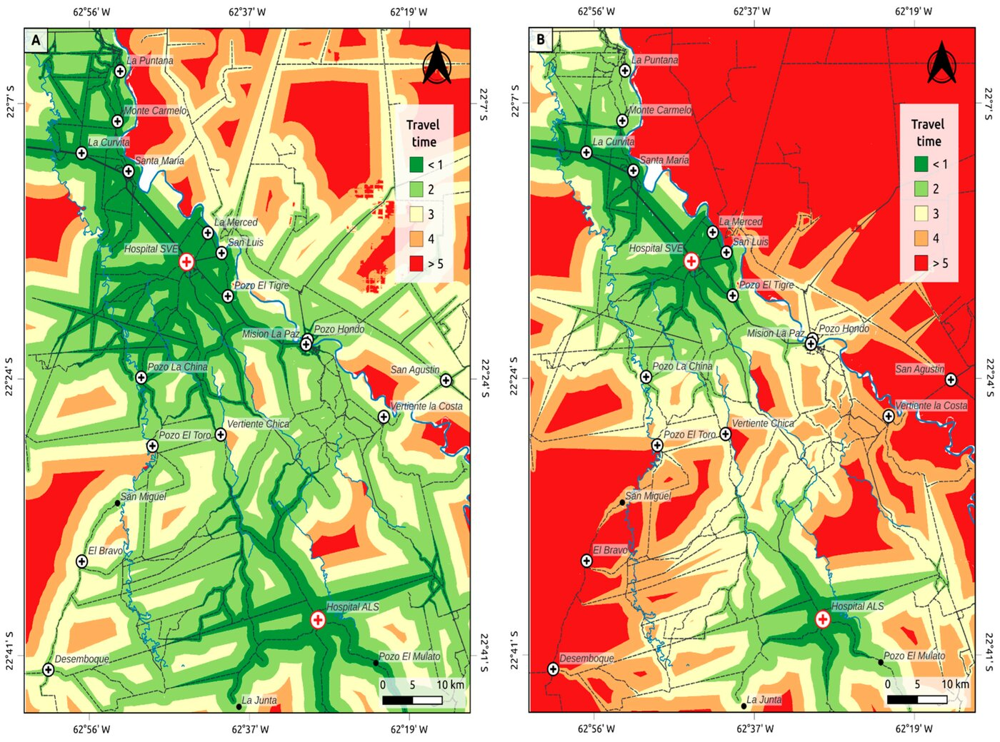

[PDF](https://doi.org/10.3390/ijerph23101248)

## Abstract

Background: Geographical accessibility to health services is essential for equitable health systems. This cross-sectional study assessed spatial accessibility to health services in the Argentina–Paraguay border region of the Gran Chaco (estimated population 27,113). Methods: All 16 health posts and two hospitals in the area were surveyed. Structured surveys and field interviews with health staff, conducted in 2023, provided workforce and facility capacity data, combined with geospatial accessibility modelling. Travel times to hospitals and health posts were estimated under favourable and unfavourable conditions using road networks, land cover, terrain, and high-resolution population data from dasymetric mapping. Geographical coverage was evaluated using a 60 min travel time threshold, while effective coverage incorporated facility-specific workforce capacity. Results: Under favourable conditions, 31.7% of the population lived more than 60 min from hospital care, with accessibility worsening under seasonal road deterioration. Hospital capacity was sufficient combining physicians and nurses, but insufficient with physicians alone. Primary health posts substantially expanded geographical access, although 21.8% of the population remained outside effective coverage. Conclusions: Geographical isolation, seasonal constraints, and limited workforce capacity jointly restrict access to health services. Integrating accessibility modelling with workforce information provides evidence to guide equitable health planning in rural and cross-border settings.

{fig-alt="Spatial accessibility to hospitals in the tri-border region under favourable (A) and unfavourable (B) scenarios. Travel time classes are expressed in hours." .featured-figure}

## Citation

C. Rodríguez González, S. Ávila, K. Cardone, M. Fernández, F. Crudo, M. V. Periago, et al. (2026). Spatial Accessibility to Health Services in the Argentina–Paraguay Border Region of the Gran Chaco. *International Journal of Environmental Research and Public Health, 23(10), 1248*. <https://doi.org/10.3390/ijerph23101248>
